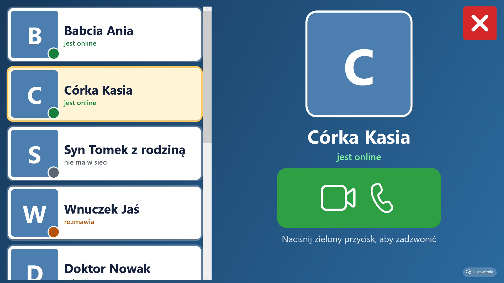
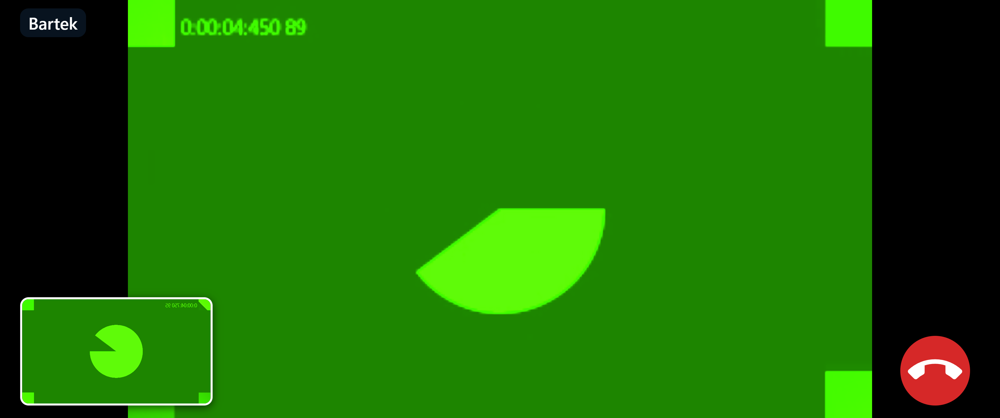
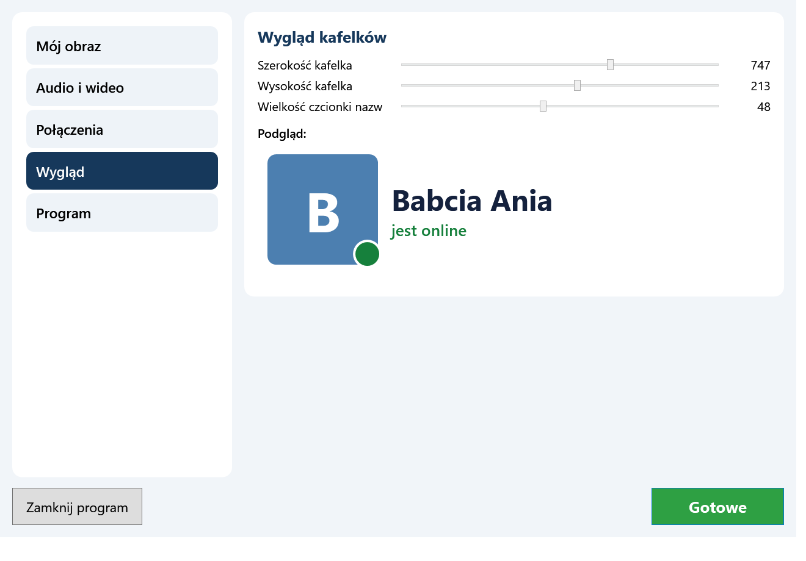
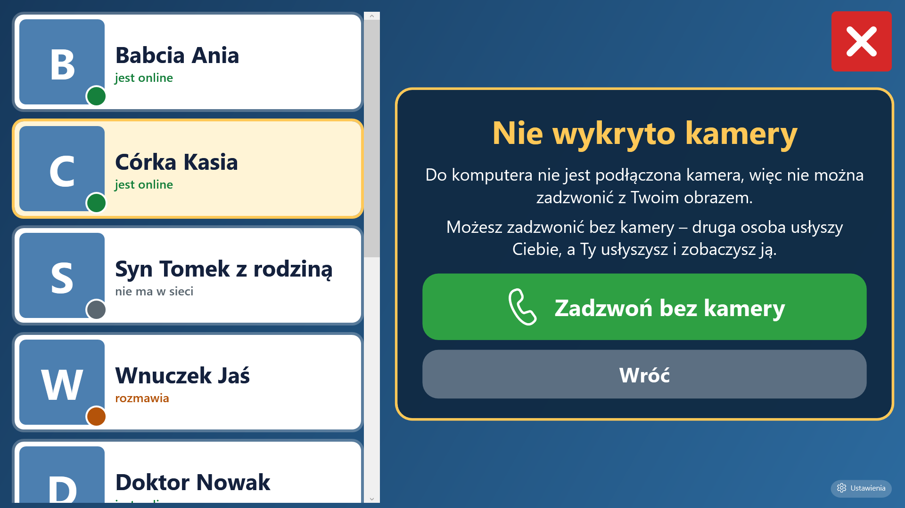

<p align="center"></p>

# PoGGaduchy

**Prosty program do rozmów wideo dla rodziny – dla osób starszych i słabowidzących (Windows 10/11).**

Duże, kontrastowe kafelki z osobami i wskaźnikiem „jest online”. Jedno kliknięcie wybiera osobę, drugie (wielki zielony
przycisk z kamerką) dzwoni. Rozmowa przychodzi na cały ekran z wielkim zielonym „Odbierz” i czerwonym „Odrzuć”. Podczas
rozmowy w prawym dolnym rogu świeci duża czerwona słuchawka. Rozmowy toczą się **bezpośrednio między komputerami**
(WebRTC, szyfrowane), a serwer w chmurze tylko łączy ze sobą rodzinę – i nie widzi ani obrazu, ani dźwięku rozmów.

> ### 🤖 Program powstaje z intensywnym udziałem AI
> Ten projekt jest tworzony we współpracy z asystentem AI (**Claude**, Anthropic). AI napisało większość kodu, tekstów
> interfejsu i tę dokumentację, na podstawie wymagań i uwag właściciela projektu, który kierował pomysłem i sprawdzał
> program w działaniu. Kod miał **ograniczony przegląd przez człowieka** i był testowany głównie na **Windows 11**. Przejrzyj
> go, zanim zaczniesz na nim polegać. Zgłoszenia błędów i propozycje zmian są mile widziane.

| Lista osób | Rozmowa przychodzi | Rozmowa |
|---|---|---|
|  |  |  |

*(Zrzut rozmowy pokazuje sztuczną kamerę testową.)*

## Funkcje

* **Kafelki osób** po lewej: zdjęcie po lewej stronie kafelka, nazwa po prawej, kolorowa kropka i napis „jest online”,
  „rozmawia” albo „nie ma w sieci”. Szerokość, wysokość kafelka i wielkość czcionki ustawia się suwakami.
* **Wybrana osoba**: na środku u góry duże zdjęcie z podpisem, pod spodem zielony przycisk z kamerką i słuchawką.
* **Rozmowa wideo jednym przyciskiem.** Okno rozmowy jest zmaksymalizowane, a w prawym dolnym rogu świeci wielka czerwona
  słuchawka, która kończy rozmowę. Mały podgląd własnego obrazu jest w lewym dolnym rogu.
* **Rozmowa przychodząca**: pełnoekranowy komunikat z dużym zdjęciem i nazwą osoby, dzwonek, wielki zielony „Odbierz”
  i czerwony „Odrzuć” (z klawiatury: Enter / Spacja – odbierz, Esc – odrzuć).
* **Własny obraz widoczny u wszystkich**: każdy ustawia swoje zdjęcie (Ustawienia → „Mój obraz”: przesuwanie, powiększanie,
  pomniejszanie, obrót). Zdjęcie trafia na serwer i pojawia się na kafelkach u pozostałych osób (zapisane też na dysku, więc
  widać je bez internetu). Każdy zmienia tylko swój obraz.
* **Samodzielne zakładanie konta**: nowa osoba uruchamia program bez żadnego pliku i zamiast komunikatu o błędzie dostaje
  propozycję założenia konta (wybiera imię i może dodać zdjęcie). Program sam tworzy konto na serwerze i zapisuje dla niej plik
  `kod-instalacji.txt`, po czym uruchamia się ponownie już jako ta osoba. Do czasu akceptacji konto jest oznaczone jako
  **NEW**: nowa osoba widzi tylko administratora i może rozmawiać tylko z nim, a reszta rodziny jej nie widzi i nie dostaje od niej
  połączeń. Administrator dostaje komunikat, a w Ustawieniach → „Osoby” widzi takie konto w innym kolorze z napisem **NEW** i może
  je **zaakceptować** albo **usunąć**. Nieakceptowane konta znikają po 14 dniach, a oczekujących może być jednocześnie najwyżej 5.
* **Administrator**: osoba z plikiem `Admin.PMa` obok programu (patrz niżej) widzi w ustawieniach grupę „Osoby (administrator)”:
  dodaje i usuwa osoby, zmienia ich nazwy, ustawia obraz każdej osoby i wydaje nowe kody instalacji. Zwykłe osoby tej grupy nie widzą.
* **Audio i wideo** (Ustawienia): wybór mikrofonu, głośników i kamery, podgląd kamery, wskaźnik poziomu mikrofonu i próba
  głośników. Zmiana działa od razu, także **w trwającej rozmowie**.
* **Ustawienia także podczas rozmowy**: mały przycisk w prawym górnym rogu okna rozmowy (też trzeba przytrzymać 1 s).
* **Automatyczne odbieranie** od wskazanych, zaufanych osób (Ustawienia → „Połączenia”).
* **Brak kamery**: duża informacja „Nie wykryto kamery” i przycisk „Zadzwoń bez kamery” (rozmowa bez Twojego obrazu;
  drugą osobę nadal widać). Brak mikrofonu albo zajęta kamera też nie przerywają rozmowy, a program mówi, co się stało.
* **Samo ponawia nieudane kroki**: połączenie z serwerem jest stale podtrzymywane i wznawiane po zerwaniu, po powrocie
  sieci i po wybudzeniu komputera; dzwonienie czeka na połączenie z serwerem; zerwane połączenie obrazu jest odtwarzane
  (ponowne uzgodnienie ścieżki sieciowej) przez minutę, zanim program zakończy rozmowę; obrazy osób pobierają się do skutku.
* **Kamera i mikrofon bez pytań**: zgoda jest wbudowana w program i dotyczy tylko jego strony rozmowy.
* **Bezpieczne ustawienia**: przycisk „Ustawienia” (na dole po prawej) trzeba **przytrzymać przez 1 sekundę**. Krótkie
  kliknięcie pokazuje na 3 sekundy podpowiedź. Czerwony przycisk **X** (128 × 128) w prawym górnym rogu wyłącza program.
* Zawsze uruchamia się **zmaksymalizowany**; **startuje razem z Windows**. Druga uruchomiona kopia nie otwiera nowej,
  tylko wysuwa pierwszą (a gdy trwa rozmowa – okno rozmowy).
* **Automatyczne aktualizacje** z GitHub Releases, także **ciche** (bez pytania) – obie funkcje można wyłączyć w Ustawieniach.
* Dane (ustawienia, zdjęcia, log) leżą **obok pliku `.exe`**.

Grupy w Ustawieniach: **Mój obraz**, **Audio i wideo**, **Połączenia**, **Wygląd**, **Osoby (administrator)**, **Program**.

| Ustawienia | Brak kamery |
|---|---|
|  |  |

## Jak to działa

```
 komputer A (PoGGaduchy.exe)                                  komputer B (PoGGaduchy.exe)
   ├─ WPF + WebView2 (WebRTC) ◄──────── obraz i dźwięk, szyfrowane (P2P lub przez TURN) ────────► ...
   └─ WebSocket ─► Cloudflare Worker + Durable Object (obecność, „X dzwoni do Y”, dane negocjacji) ◄─ WebSocket
                                  ├─ katalog osób i ich małe obrazy (baza SQLite w Durable Object)
                                  └─ wydaje krótko ważne poświadczenia TURN (Cloudflare Realtime TURN)
```

* **Serwer** (katalog [`server/`](server)) to jeden Cloudflare Worker z jednym Durable Object i połączeniami WebSocket w trybie
  hibernacji. Przekazuje tylko: kto jest online, „dzwoni”, „odebrał / odrzucił / rozłączył” i dane negocjacji połączenia.
  Przechowuje też katalog osób (nazwy) i ich obrazy (kwadratowe JPEG-i do 250 KB). Podtrzymanie połączenia to ramki
  `ping`/`pong` obsługiwane automatycznie przez platformę (bez budzenia obiektu i bez zużywania limitu); zerwane połączenia
  są usuwane z listy „online” po ok. 100 s.
* **Dostęp**: każda kopia programu ma długi, losowy, tajny klucz (256 bitów). Serwer zna tylko **skróty SHA-256** dozwolonych
  kluczy. Obca osoba bez klucza nie może ani się zalogować, ani zadzwonić do rodziny; błędne próby z jednego adresu IP są
  ograniczane (po 10 w minucie – odpowiedź 429), a ramki z jednego połączenia mają limit szybkości i rozmiaru.
* **Konta NEW**: serwer przyjmuje `POST /api/register` bez klucza (limit: 10 prób na minutę z jednego adresu IP, najwyżej 5 oczekujących kont), ale takie konto jest niewidoczne dla rodziny i może dzwonić tylko do administratora.
* **Administrator**: tekst z pliku `Admin.PMa` jest wysyłany do serwera razem z kluczem osoby; serwer zna tylko jego skrót
  (sekret `ADMIN_HASH`). Samo istnienie pliku nic nie daje – o uprawnieniach decyduje serwer. **Kto skopiuje plik `Admin.PMa`,
  staje się administratorem**, więc trzymaj go tylko u siebie i nie wysyłaj razem z programem do rodziny.
* **TURN** (jeśli skonfigurowany; patrz niżej): gdy bezpośrednie połączenie nie jest możliwe (np. za zaporą), obraz i dźwięk
  idą przez Cloudflare Realtime TURN. Dane uwierzytelniające wydaje serwer i ważne są tylko przez ograniczony czas
  (domyślnie 6 godzin).
* **Limity darmowego planu Cloudflare** (m.in. 100 000 żądań dziennie) wystarczają dla ok. 10 osób: program nie wysyła
  „pingów” co sekundę, a podtrzymanie połączenia idzie przez auto-odpowiedź.

## Instalacja i konfiguracja (dla osoby, która przygotowuje program dla rodziny)

### 1. Serwer na Cloudflare (jednorazowo, darmowe konto)

Potrzebny jest Node.js tylko do wdrożenia serwera (do samego programu nie jest potrzebny). Wystarczy **przenośny** Node
(zip z nodejs.org rozpakowany do `%USERPROFILE%\tools\`) – skrypty same go znajdują (albo ustaw zmienną `PGG_NODE`).

```powershell
cd server
npm install                                  # pobiera wranglera (narzędzie Cloudflare)
.\node_modules\.bin\wrangler login           # logowanie do Cloudflare w przeglądarce
cd ..
.\tools\wdroz.ps1                            # wdraża serwer i zapisuje jego adres (*.workers.dev)
```

**TURN (opcjonalnie, ale zalecane)**: bez niego program działa na samych serwerach STUN, co wystarcza w większości domowych
sieci, ale rozmowa nie połączy się, gdy któraś osoba jest za „trudnym” routerem (CGNAT u operatora, sieć firmowa).
Cloudflare wymaga do włączenia Realtime podania metody płatności (pierwsze 1000 GB miesięcznie jest bezpłatne; płatne jest
dopiero to, co ponad limit). Po utworzeniu klucza (panel Cloudflare: Realtime → TURN Server → Create) wpisz jego dane
skryptem (wartości wpisujesz samodzielnie, skrypt ich nie wyświetla i nie zapisuje w plikach):

```powershell
.\tools\ustaw-turn.ps1
```

### 2. Pierwsze osoby i administrator

Pierwsze osoby (przynajmniej administrator) dodajesz skryptem – kolejne osoby administrator dodaje już w samym programie
(Ustawienia → Osoby). Skrypt tworzy klucz osoby, zapisuje **skrót** klucza na serwerze (`server\members.json`, poza
repozytorium) i tworzy plik `instalacje\<id>\kod-instalacji.txt`:

```powershell
.\tools\dodaj-osobe.ps1 -Id mama -Nazwa "Mama" -Serwer https://poggaduchy.twoje-konto.workers.dev
.\tools\dodaj-osobe.ps1 -Id tata -Nazwa "Tata"
.\tools\wyslij-osoby.ps1                       # wysyła listę jako sekret MEMBERS (tylko pierwsze wczytanie!)
```

Uwaga: lista z `wyslij-osoby.ps1` jest wczytywana do bazy serwera **tylko przy pierwszym uruchomieniu**; potem jedynym
źródłem jest baza zarządzana przez administratora w programie. Pliki `kod-instalacji.txt` zawierają **tajne klucze** –
przekazuj je tylko właściwym osobom.

**Administrator**: utwórz plik `Admin.PMa` z długim, losowym tekstem i ustaw jego skrót na serwerze:

```powershell
.\tools\ustaw-admina.ps1 -Plik .\Admin.PMa -Generuj    # tworzy silny losowy tekst w pliku i ustawia jego skrót
```

Plik `Admin.PMa` kładziesz obok `PoGGaduchy.exe` na komputerze administratora (i tylko tam). Przy `-Generuj` nowy tekst
zastępuje zawartość pliku; bez `-Generuj` skrypt używa istniejącego tekstu (krótki, łatwy do odgadnięcia tekst daje słabą ochronę).

### 3. Program na komputerze osoby

Program to jeden plik `PoGGaduchy.exe` (nie wymaga instalowania .NET; pobierasz go z [wydania](../../releases)). Są dwie drogi:

**A. Osoba zakłada konto sama (najprościej).** Dajesz jej tylko `PoGGaduchy.exe`. Po uruchomieniu wybiera imię (i zdjęcie), a
program sam tworzy konto i plik `kod-instalacji.txt`. Zostaje jeszcze **akceptacja** przez administratora (Ustawienia → Osoby →
konto z napisem NEW → „Zaakceptuj konto”). Adres serwera nowy program bierze z pliku [`server.json`](server.json) w tym
repozytorium (na GitHubie), więc zmiana serwera nie wymaga nowego wydania.

**B. Administrator tworzy konto z góry.** Ustawienia → Osoby → „+ Dodaj osobę…”: program zapisuje na serwerze skrót klucza i
tworzy plik `kod-instalacji.txt` w folderze `Nowe osoby\<id>` obok programu (bez kopii programu i bez zipa). Ten plik osoba
kładzie obok `PoGGaduchy.exe`. Plik zawiera tajny klucz – przekaż go tylko tej osobie. Dla osób dodanych skryptem:

```powershell
.\tools\przygotuj-kopie.ps1 -Id mama                       # dist\kopie\mama\kod-instalacji.txt
.\tools\przygotuj-kopie.ps1 -Id mama -Katalog D:\Mama      # kod trafia do wskazanego katalogu osoby
```

Program sam wpisze się do autostartu Windows. Osoby z serwera pojawiają się na kafelkach automatycznie, a swoje zdjęcie każdy
ustawia raz w Ustawieniach (przytrzymaj przycisk 1 sekundę → „Mój obraz”).

Wymagania: Windows 10/11 (64-bit) ze składnikiem **Microsoft Edge WebView2** (jest w Windows 11 i w aktualnym Windows 10).

## Aktualizacje

Program co kilka godzin pyta GitHub o najnowsze wydanie repozytorium zapisanego w `Source/Models.cs`
(`AppInfo.DefaultRepository`). Nowsza wersja jest pobierana w tle, a jej suma **SHA-256** jest sprawdzana (z pliku
`.sha256` wydania lub z sumy podanej przez GitHub; bez sumy aktualizacja nie jest instalowana). Plik musi pochodzić z
`github.com` / `githubusercontent.com` (HTTPS) i być programem (`MZ`).

**Podpis autora (od wersji 1.2.0).** Suma SHA-256 chroni przed uszkodzeniem pliku, ale nie przed podmianą wydania przez
kogoś, kto przejąłby konto GitHub. Dlatego każde wydanie ma też plik `.zip.sig`: podpis ECDSA P-256 tekstu
„wersja + SHA-256 pliku zip”. Klucz **publiczny** jest wbudowany w program (`Source/Assets/update-public-key.txt`), klucz
**prywatny** (zaszyfrowany hasłem) ma tylko autor i nie leży w repozytorium. Program bez poprawnego podpisu nie instaluje
aktualizacji. Wersje starsze niż 1.2.0 podpisu nie sprawdzają.

Jednorazowo: `tools\generuj-klucz-podpisu.ps1` (utworzy klucze; prywatny zapisz w menedżerze haseł razem z hasłem; po utracie
klucza programy trzeba zaktualizować ręcznie nowym plikiem `.exe`).

W Ustawieniach (grupa „Program”) są dwie niezależne opcje:

* **Sprawdzaj i pobieraj aktualizacje automatycznie** – wyłączenie zatrzymuje sprawdzanie (zostaje przycisk „Sprawdź teraz”).
* **Cicha aktualizacja** – pobrana wersja jest instalowana bez pytania, **gdy nikt nie korzysta z programu** (5 minut bez ruchu
  myszą, nie trwa rozmowa) albo **przy uruchomieniu**. Po wyłączeniu na ekranie pojawia się duży przycisk „Zainstaluj nową wersję
  programu”.

### Jak wydać nową wersję

```bash
git tag v1.2.0
git push origin v1.2.0
```

Workflow [`release.yml`](.github/workflows/release.yml) zbuduje program (numer wersji bierze z tagu), spakuje do
`PoGGaduchy-1.2.0-win-x64.zip`, doda sumę `.sha256` i opublikuje wydanie (z informacją o udziale AI w opisie).
Potem podpisz wydanie na swoim komputerze (podasz hasło do klucza):

```powershell
powershell -ExecutionPolicy Bypass -File tools\podpisz-wydanie.ps1 -Wersja 1.2.0
```

Do czasu dodania podpisu programy pomijają to wydanie i sprawdzą je ponownie przy następnej okazji.

## Gdzie są ustawienia

**Obok pliku `PoGGaduchy.exe`**: `settings.json` (osoby, rozmiary, opcje, wybrane urządzenia), `kod-instalacji.txt`
(tożsamość tej kopii), opcjonalnie `Admin.PMa`, folder `images` (obrazy osób pobrane z serwera), `webview2` (dane przeglądarki
wbudowanej w rozmowę) i `log.txt`. Cały folder można skopiować na inny komputer (uwaga: ten sam kod instalacji na dwóch
komputerach naraz – drugi wypiera pierwszy). Jeśli folder programu jest tylko do odczytu, dane trafiają do `%APPDATA%\PoGGaduchy`.

## Diagnostyka

`PoGGaduchy.exe --diagnoza` (tylko odczyt, nic nie zmienia i nie wypiera działającego programu) zapisuje w `log.txt`:
wersję, WebView2, kamery i mikrofony, zgody Windows na kamerę i mikrofon, autostart, kod instalacji, plik `Admin.PMa`
oraz odpowiedź serwera (w tym, czy działa TURN).

**Gdy w rozmowie „nie widać obrazu”**: w `log.txt` po połączeniu są linie `[statystyki]` (co 5 s przez pół minuty): ile
pakietów i klatek wideo odebrano i wysłano, jaki jest rozmiar obrazu, czy kamera działa. Z nich widać, czy obraz w ogóle
dociera, czy tylko nie jest wyświetlany. Wyślij oba pliki `log.txt` (z obu komputerów) osobie, która utrzymuje program.

## Budowanie z kodu i testy

Wymagany [.NET 8 SDK](https://dotnet.microsoft.com/download/dotnet/8.0) na Windows.

```bash
cd Source
dotnet build          # wersja debug
cd ..
build.cmd             # samodzielny PoGGaduchy.exe w tym folderze
```

Testy (opisy w nagłówkach skryptów):

* `tools\test-all.ps1` – pełna regresja jednym poleceniem: uruchamia lokalny serwer z czystym stanem i wszystkie testy poniżej.
* `server/test/protocol.mjs` – protokół serwera (logowanie, obecność, dzwonienie, odrzucanie, wznawianie, TURN…),
  `server/test/api.mjs` – obrazy osób, uprawnienia, administrator (dodawanie, usuwanie, nowy klucz),
  `server/test/stale.mjs` – sprzątanie zerwanych połączeń. Uruchamiane na lokalnym serwerze (`npm run dev`).
* `tools/test-call.ps1` – dwie kopie programu na jednym komputerze (osobne foldery danych) dzwonią do siebie przez serwer,
  sterowane przez UI Automation i mysz: odebranie, odrzucenie, rezygnacja, brak kamery, odbieranie automatyczne, odbierający
  bez kamery, ustawienia w trakcie rozmowy, opcjonalnie wymuszony przekaźnik TURN (`-ForceRelay`).
* `tools/test-ui.ps1` – przytrzymanie przycisku ustawień, podpowiedź po krótkim kliknięciu, przycisk X.
* `tools/test-settings.ps1` – grupy ustawień dla zwykłej osoby i administratora, własny obraz widoczny u drugiej osoby,
  obraz innej osoby ustawiony przez administratora, dodanie i usunięcie osoby.
* `tools/shots.ps1` – zrzuty okien dla różnych rozmiarów ekranu (układ sprawdzany m.in. dla 1280×720, 1536×864, 1920×1080
  i 3440×1440 przy skalowaniu Windows 100–150%).

Zmienne środowiskowe tylko do testów: `PGG_DATA` (inny folder danych), `PGG_FAKE_MEDIA=1` (sztuczna kamera i mikrofon),
`PGG_NO_CAMERA=1`, `PGG_FORCE_RELAY=1`, `PGG_NO_UPDATE=1`, `PGG_TEST_PHOTO` (plik zdjęcia zamiast okna wyboru), `PGG_SERVER` (adres serwera wprost, bez pobierania `server.json`),
`PGG_REPO` (inne repozytorium aktualizacji).

## Znane ograniczenia

* Program musi być uruchomiony, a komputer nie może być uśpiony, żeby dało się do niego zadzwonić.
* **Bez skonfigurowanego TURN** (stan domyślny, dopóki nie wykonasz kroku z `ustaw-turn.ps1`) rozmowa łączy się tylko wtedy,
  gdy da się ją nawiązać bezpośrednio między komputerami. Ścieżka przez przekaźnik TURN jest zaimplementowana, ale
  **nie była jeszcze sprawdzona w praktyce**.
* Dwie kopie programu na jednym komputerze z jedną fizyczną kamerą: druga nie dostanie obrazu z kamery (program to
  zauważa i pokazuje komunikat). Prawdziwe rozmowy to dwa różne komputery.
* Zapora Windows przy pierwszym połączeniu może zapytać o zgodę dla składnika `msedgewebview2.exe` (nie sprawdzano na
  świeżym systemie).
* Brak składnika WebView2 (rzadko, na starym Windows 10) uniemożliwia rozmowy; program pokazuje wtedy komunikat.
* Zmiany administratora (nowa osoba, nowa nazwa) są widoczne u wszystkich od razu; usunięta osoba traci dostęp w ciągu
  około pół minuty (pamięć podręczna serwera).
* Tylko rozmowy jeden na jeden, bez czatu tekstowego i bez aplikacji mobilnej.

## Licencja

[MIT](LICENSE) © NepciorLab
